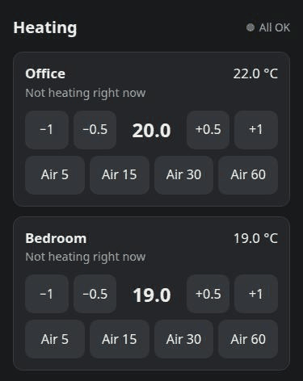

# heating-control

A small web page to adjust the heating per room from a phone on the home network: change a room's target temperature, or mark a window as open so the room doesn't heat. It controls Sonoff TRVZB thermostats through Zigbee2MQTT.

The page can be added to the phone's home screen with its own icon: "Share → Add to Home Screen" in Safari, "Add to home screen" in Chrome. On iPhone it then opens full-screen. Android Chrome only installs a page as an app over HTTPS, so over plain HTTP it adds a shortcut, which may open as a normal browser tab. The page has no service worker and caches nothing, so it always shows the live state and only works on the home network. Offline use or notifications would need HTTPS too. The icons are drawn by `internal/web/icon.go`: change it and run `go generate ./...`.

## Airing

"Air 5/15/30/60" sends `system_mode: off` for that many minutes, with 5 for a quick Stoßlüften. When the time is up, or on "Heat again", the room gets back the mode and target from before.

The service keeps no saved state, so a restart during airing forgets it: **that room stays off until someone taps "Heat again"**. A target waiting to be sent is lost too. The thermostat's own frost protection still applies.

- A target changed during airing is applied when it ends.
- A thermostat leaving off during airing gets off once more. If it leaves off again, someone is at the radiator, so airing ends. So turning it on by hand during airing takes two tries.
- Commands repeat until the thermostat confirms them, every 30 s for about 5 minutes. A target then gives up and shows the thermostat's value. Off and heat-again keep trying every 5 minutes and show a problem on the page, because giving up would mean heating with the window open or a cold room.
- A thermostat that is off with no airing is left alone, because someone may have turned it off on purpose. The page offers "Heat again" for it.

## Requirements

| Needs | Why | Tested with |
| :--- | :--- | :--- |
| MQTT broker | How the service reaches Zigbee2MQTT. It connects without a username or TLS, because those aren't supported yet | Mosquitto 2.1 |
| [Zigbee2MQTT](https://www.zigbee2mqtt.io/) | Talks to the thermostats. The service uses `<baseTopic>/<trv>` for state, and `/set` and `/get` for commands, with device friendly names from the config | 2.14 |
| Sonoff TRVZB thermostats | The service relies on how they behave, see the comment in [`controller.go`](internal/controller/controller.go), so **other models may not work** | Firmware 1.3.0 |

Optional:

- **A room sensor** in Zigbee2MQTT that reports `temperature`, for the temperature on the page. Without one, the page shows the thermostat's value. A thermostat only regulates on a room sensor if something else feeds it `external_temperature_input`: this service doesn't.
- **Prometheus Operator**, for the chart's `serviceMonitor.enabled`. `/metrics` works without it.

The chart needs Kubernetes and Helm. Without them, run the binary or image with `-config <file>`, using the same settings as `config` in the chart's [`values.yaml`](charts/heating-control/values.yaml).

Nothing else is needed: no database, and no storage, because all state is in memory.

## Deployment

The Helm chart in [`charts/heating-control`](charts/heating-control) is published with every release as `oci://ghcr.io/subpathdev/charts/heating-control`. Set `config.broker` and `config.rooms`; adding a room is one more entry in `config.rooms`. Run one replica only, and give any other instance its own `config.clientId`: a second client with the same ID disconnects the first.

## API

[`internal/api/openapi.yaml`](internal/api/openapi.yaml) (OpenAPI 3.0) is the contract between the backend and the page, and a running server also serves it at `/api/openapi.yaml`. The Go types and server interface are generated from it, so change the file first, then run `go generate ./...`. CI fails if the generated code is out of date. `/healthz`, `/readyz` and `/metrics` are for operations and aren't part of the contract.

## Releases

Merging to `main` releases automatically, based on [conventional commits](https://www.conventionalcommits.org/): `feat:` is a minor bump and `fix:` a patch, while `docs:`, `ci:`, `chore:` and the like don't release. While the version is 0.x, a breaking change is a minor bump too. A release publishes `ghcr.io/subpathdev/heating-control:<version>`, the Helm chart of the same version and a GitHub release. To deploy it, merge the chart bump in the repo that runs it.
